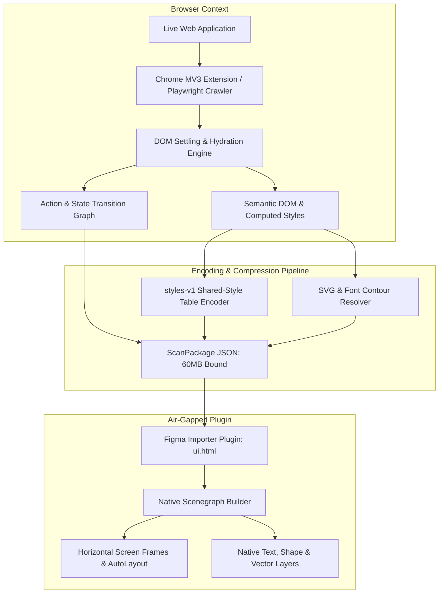

# Siteframe

<p align="center">
  <strong>Deterministic Web-to-Design Engine & Lossless Stacking Layout Pipeline (Playwright Discovery, styles-v1 Table Compression & Offline Figma Scenegraph Importer).</strong>
</p>

---

## Key Capabilities

- **Zero-LLM Deterministic Reconstruction:** Converts complex website routes and interaction states into native, fully editable Figma layers without AI hallucinations or pixel approximations.
- **Lossless Shared-Style Table (`encoding: styles-v1`):** Compresses computed CSS properties across thousands of DOM nodes into a normalized reference table, bounding exports under 60 MB.
- **Stacking Context & Z-Index Synthesis:** Reconciles CSS stacking contexts, 3D transforms, and fixed/sticky navigation headers into correct Figma layer hierarchy.
- **Multi-Route & Interactive State Discovery:** Autonomous crawler maps tab transitions, modals, and route graphs into structured design packages.
- **Offline Air-Gapped Figma Importer:** Desktop Figma plugin parses JSON packages locally without cloud tokens or external network calls (`networkAccess: { allowedDomains: ["none"] }`).

---

## System Architecture



For the complete architectural design and data flow, see [ARCHITECTURE.md](./ARCHITECTURE.md).

---

## Monorepo Architecture

```text
siteframe/
├── ARCHITECTURE.md          # Complete technical specification and layout math
├── LICENSE                  # Strict Proprietary & Confidential Showcase License
├── compose.yaml             # Local Redis and PostgreSQL container services
├── package.json             # Monorepo workspace configuration
├── packages/
│   ├── shared-types/        # Runtime Zod schemas, ScanPackage interfaces, types
│   └── protocol/            # Discriminated request/response IPC protocols
└── apps/
    ├── extension/           # Chrome MV3 popup, launch broker, and monitor
    └── figma-plugin/        # Offline desktop Figma plugin and scenegraph builder
```

---

## Data Schema & Contracts

Scan packages conform to the strict TypeScript definitions in `packages/shared-types/src/index.ts`:

```typescript
export interface ScanPackage {
  formatVersion: 'siteframe-scan-1';
  siteUrl: string;
  capturedAt: string;
  encoding: 'styles-v1';
  styleTable: ComputedStyleTable;
  screens: ReconstructedScreen[];
  transitionGraph: StateTransitionEdge[];
}
```

---

## Showcase Edition Notice

> **Note:** This repository is an architectural showcase and design portfolio piece. Proprietary DOM graph traversal crawlers, styles-v1 compression engines, and native Figma node synthesizers are stubbed in accordance with the [LICENSE](./LICENSE). Direct execution or cloning for commercial use is prohibited without prior written authorization.

---

## Author & Copyright

**Created by Kartik**  
Copyright (c) 2026 Kartik. All Rights Reserved.
